```{=latex}
\begin{titlepage}
\thispagestyle{empty}
\begin{tikzpicture}[remember picture,overlay]
  % 封面绝对定位，坐标 = 距页面左上角 (pt)，版式对齐 LITEARM SE 产品手册封面
  % 封面图与中文版共用 images/ 下的两张 PNG（图本身没有语言）
  \node[anchor=north,inner sep=0pt] at ($(current page.north west)+(298.75pt,-108.9pt)$)
      {\includegraphics[width=100pt,height=112pt,keepaspectratio]{images/cover_litearm_logo.png}};
  \node[anchor=center] at ($(current page.north west)+(298.75pt,-262.4pt)$)
      {{\fontsize{28}{34}\selectfont\bfseries User Guide}};
  \node[anchor=north,inner sep=0pt] at ($(current page.north west)+(298.75pt,-300.8pt)$)
      {\includegraphics[width=289.1pt,height=289.1pt,keepaspectratio]{images/cover_litearm_se.png}};
  \node[anchor=center] at ($(current page.north west)+(298.75pt,-717.8pt)$)
      {{\fontsize{11}{14}\selectfont\bfseries NEXFORM ROBOTICS}};
  \node[anchor=center] at ($(current page.north west)+(298.75pt,-747.9pt)$)
      {{\fontsize{9}{13}\selectfont Version 1.0\qquad 13 October 2026}};
\end{tikzpicture}
\end{titlepage}
\pagenumbering{Roman}
\thispagestyle{frontmatter}
\tableofcontents
\clearpage
\pagenumbering{arabic}
```

# Introduction

What does it take to install a robot arm for the first time, such that it is actually assembled and running reliably? For developers, engineers, and robotics enthusiasts who are new to robot arms, the goal of the installation stage is usually not to write code but to get the device assembled safely and firmly, and connected up.

This guide covers the complete flow for the LITEARM-SE, from unpacking and checking the parts through mechanical assembly and electrical connection to installing, activating, and first using the host application. Read it before you start, and check the parts against the packing list first.

The order matters: **assemble the arm first, then connect power and cables.** Assembly means turning the arm over, lining up holes, and tightening screws. Do that work before the cables are attached, and no cable gets pulled around during assembly or ends up inside a joint's range of motion.

LITEARM-SE can be installed in either of two ways. Pick the one that matches how you will use it. Both share the same electrical connection procedure:

- **Option 1 | Tabletop mount**: fix the arm to the base plate and clamp the plate to the edge of a table. Use this when the arm stays in one workplace.
- **Option 2 | Column mount**: build a column base from the X-shaped base plate, the feet, the casters, the column, and the top mount, then assemble the arm onto it. Use this when you need to adjust the mounting height, or when you need the teleoperation configuration.

**Keywords**: robot arm installation, unpacking, tabletop mount, column mount, electrical connection, software installation, license activation

## Installation path

You do **not** need both paths. Decide which mount you are using, then read according to this table: chapters 2, 5, and 6 apply either way, and the only choice is between chapter 3 and chapter 4. Read chapter 7 (Q&A) when you need it.

| Chapter | Content | Tabletop mount | Column mount |
| --- | --- | --- | --- |
| 1 | Introduction | Required | Required |
| 2 | Unpacking: check that all parts are present | Required | Required |
| 3 | Tabletop mount: fix the arm to a table | **Required** | Skip |
| 4 | Column mount: build the column base and assemble the arm | Skip | **Required** |
| 5 | Electrical connection: power and communication (including installation notes) | Required | Required |
| 6 | Software quick start: install, activate, and use | Required | Required |
| 7 | Q&A: common questions | Optional | Optional |

- **Tabletop mount**: read chapters 2, 3, 5, and 6. **Skip chapter 4 entirely.**
- **Column mount**: read chapters 2, 4, 5, and 6. **Skip chapter 3 entirely.**

# Unpacking: check that all parts are present

Before you start, check that the arm and its accessories are all in the box. Packing list:

- Robot arm
- Controller board
- USB cable
- Robot arm power output
- 600 W switching power supply kit (optional)
- Tabletop mount kit (optional)
- Column kit (optional)

Points to watch while you check:

- Check the parts for the mount you chose. For the **tabletop mount**, make sure the tabletop mount kit is complete; for the **column mount**, make sure the column kit is complete.
- The controller board, the USB cable, and the robot arm power output are all used in chapter 5. Keep them together within reach so that the wiring step goes faster.
- Finish the check first, and do not apply power yet.
- If a part is missing or damaged, contact support before you go on. Do not force non-matching parts to fit.

# Tabletop mount: fix the arm to a table

The arm generates inertia and reaction forces as it moves. If the base is not held firmly, the arm can shift it while moving, which costs you stability and can be a safety risk. Fix the base in a stable position before you apply power or test any motion.

The tabletop mount uses the base plate and the G-clamps, and suits a fixed workplace such as a table edge. If you are using the column mount, read chapter 4 instead.

**Step 1**: use the supplied M5 screws to fix the arm to the base plate.

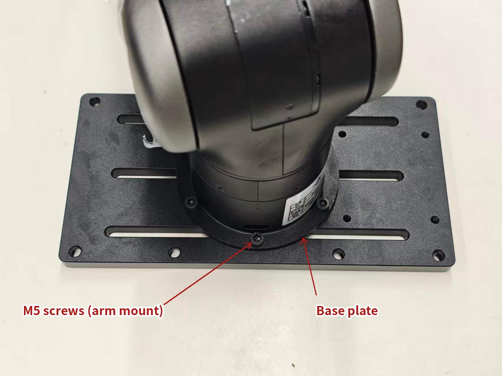

**Step 2**: put the base plate in a suitable position at the edge of the table.

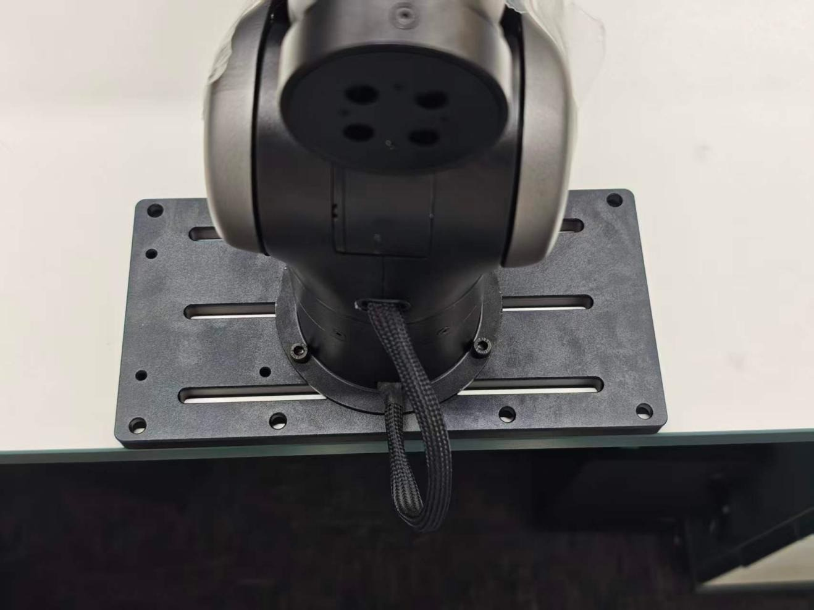

**Step 3**: use the G-clamps to clamp the base plate to the table.

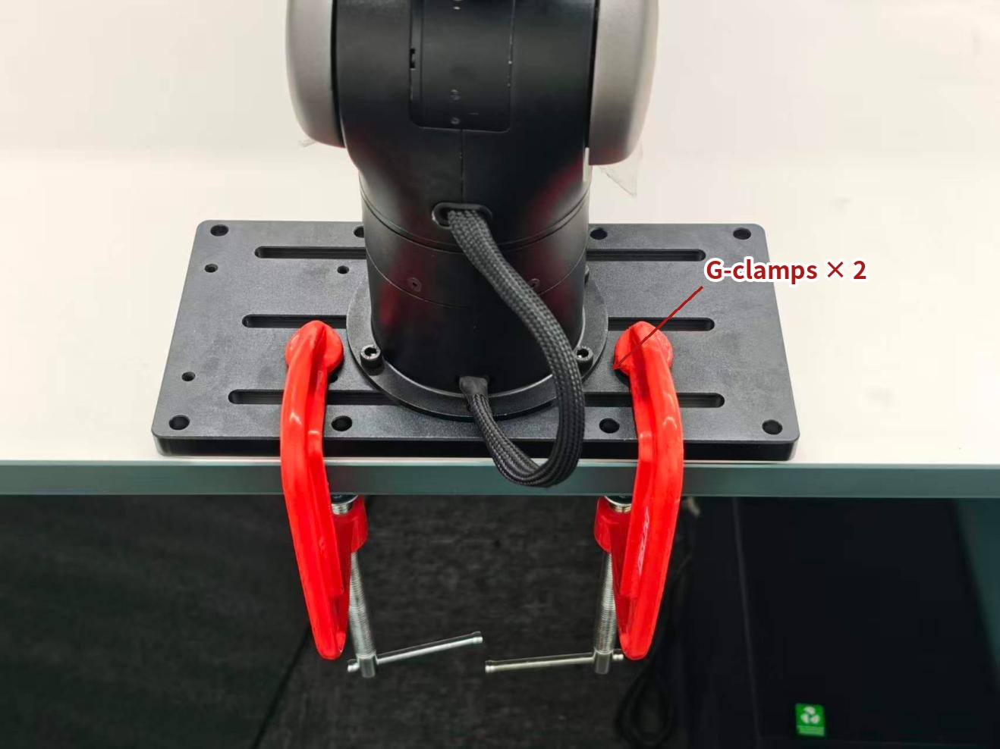

**Step 4**: check that the base plate is held firmly against the table, with no play.


**Step 5**: use the supplied screws to fix the controller board to the base plate. The tabletop mount is now complete.

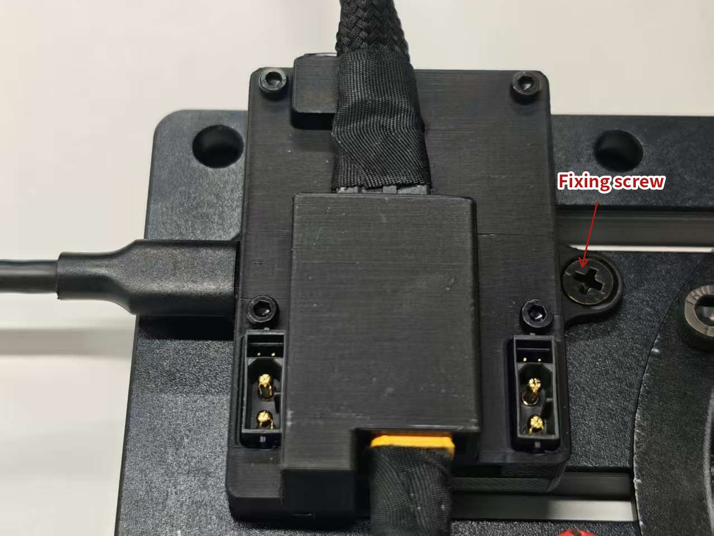

> **Tip**: when you tighten the screws, line all of them up with their holes first and then tighten them in turn. Tightening one screw all the way first shifts the holes and makes the rest hard to line up.

# Column mount: build the column base and assemble the arm

All of the mechanical assembly for the column mount happens in this chapter: first the X-shaped base plate, feet, casters, and column go together into the column base, then the arm goes onto the column, and then the cable is routed inside the column. Steps 1 to 8 run one after another. **Figure 6** shows the assembled result.


**Step 1**: turn the X-shaped base plate upside down and press the four feet into the M16 holes at its ends.

> **Note**: do not remove the nuts from the feet.

**Step 2**: use the M8 screws with washers to fit the four casters to the underside of the base plate, one after another.

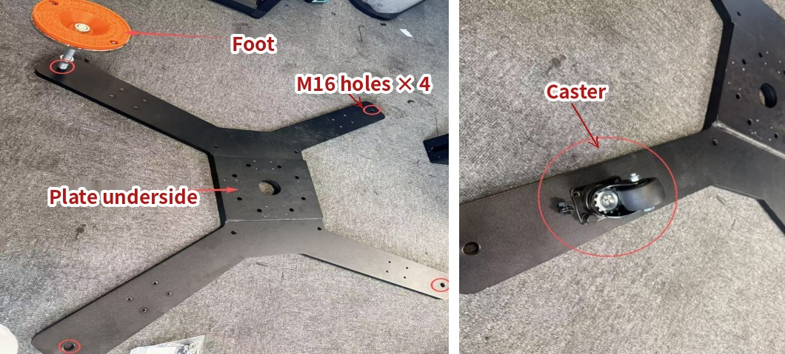

**Step 3**: turn the base plate over again, now with the feet and casters fitted. Line up the holes in the bottom of the column with the holes in the base plate and fix them with the eight M10 hex screws, washers, and nuts.

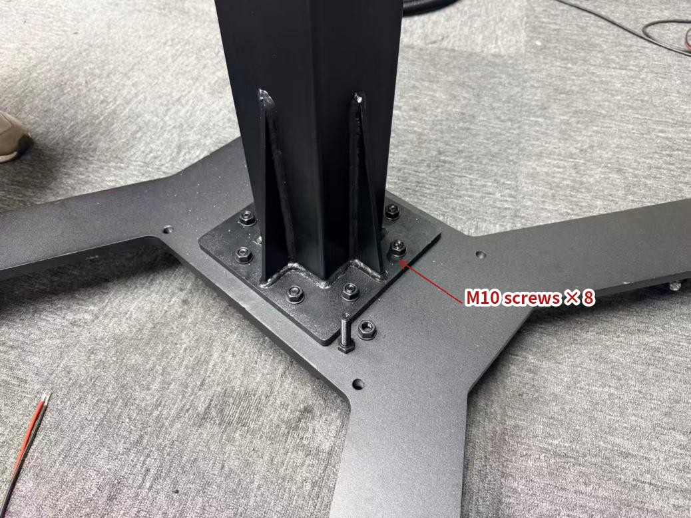

**Step 4**: fix the top mount carrying the NEXFORM logo to the top face of the column with the four M6 socket screws.

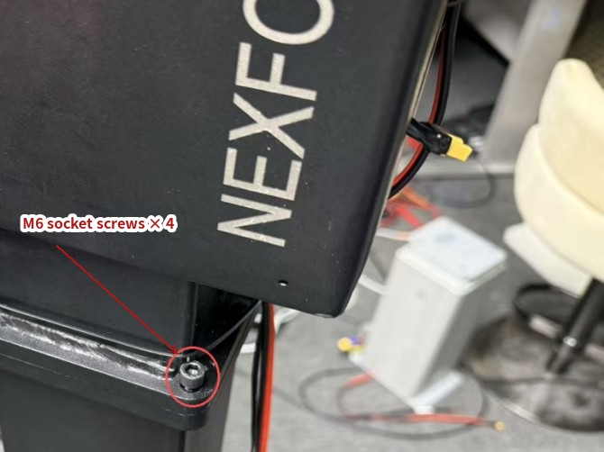

With the column base assembled, the arm can go onto the column. There are two configurations and you use **one or the other**: the teleoperation configuration if you need to move the arm by hand (fit the extension piece first, in steps 5 and 6), or direct assembly if you control the arm normally (step 7).

**Step 5**: to move the arm by hand, fit the extension piece first.

**Step 6**: line up the end of the extension piece that has no nut in it with the height you need, and fix it to the part carrying the NEXFORM logo with six M5 screws. Then fix the arm to the extension piece with six more M5 screws.

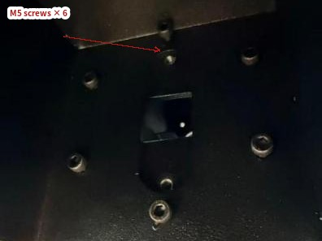

**Step 7**: to control the arm normally, fix it directly to the column at the height you need with six M5 screws.


**Step 8**: route the cable inside the column. Use the extension cable to lead the arm's power cable into the column and out through the bottom. The connection after it comes out is described in the next chapter.

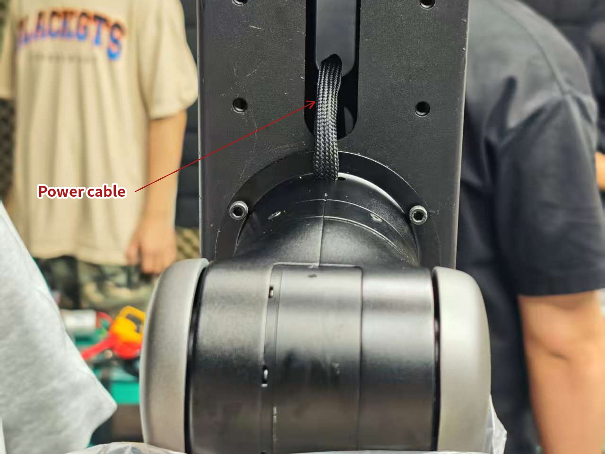

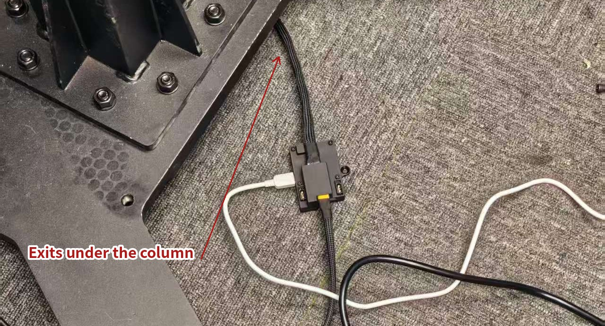

> `\color{red}`{=latex}Note: the side-mount parameters depend on the mounting direction, so the mounting direction must be changed in the host software. When both arms' power cables point straight up, as shown in the figure, set the mounting direction to +y.`\color{black}`{=latex}

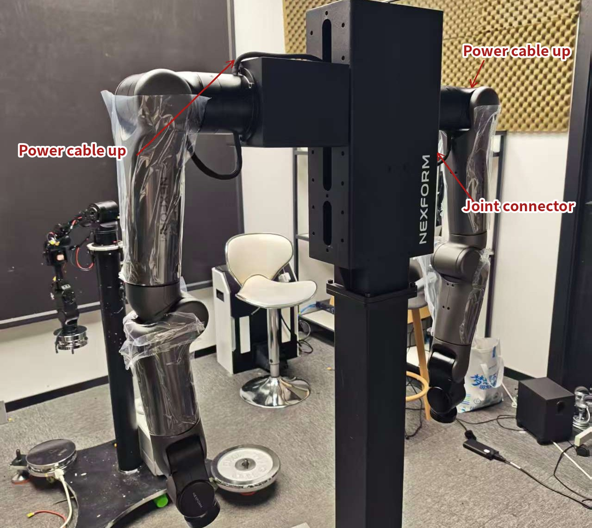

# Electrical connection: power and communication

Do the electrical connection after the mechanical assembly is complete. This set of cables carries both the system power and the link to the host computer. Do all of the wiring with everything powered off, and apply power last: that is what keeps the connectors from being mixed up or plugged in wrong.

**Step 1**: connect the power cable to the power supply module to power the system.

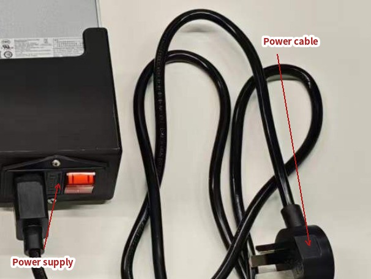

**Step 2**: connect the XT60 output of the power supply to the controller board. If you did not order the power supply module, you can power the controller board from another supply; the connection is the same.

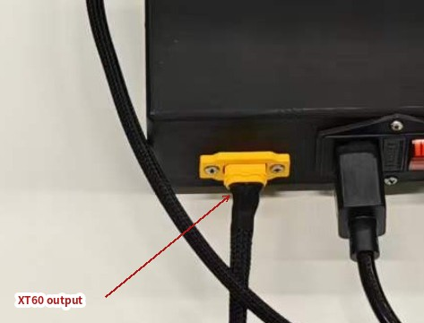

**Step 3**: connect the controller board to the port at the base of the arm.

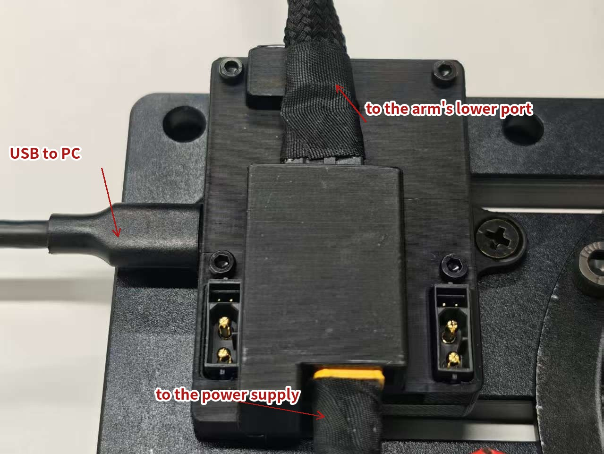

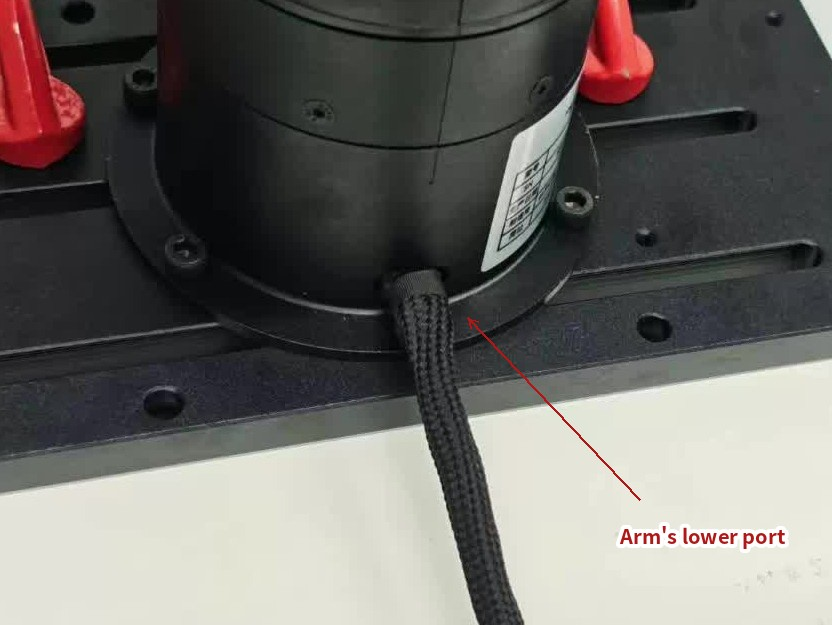

**Step 4**: connect the controller board to the PC with the USB cable.

## Wiring diagram

The cables and connectors correspond one-to-one with **Figure 19**.

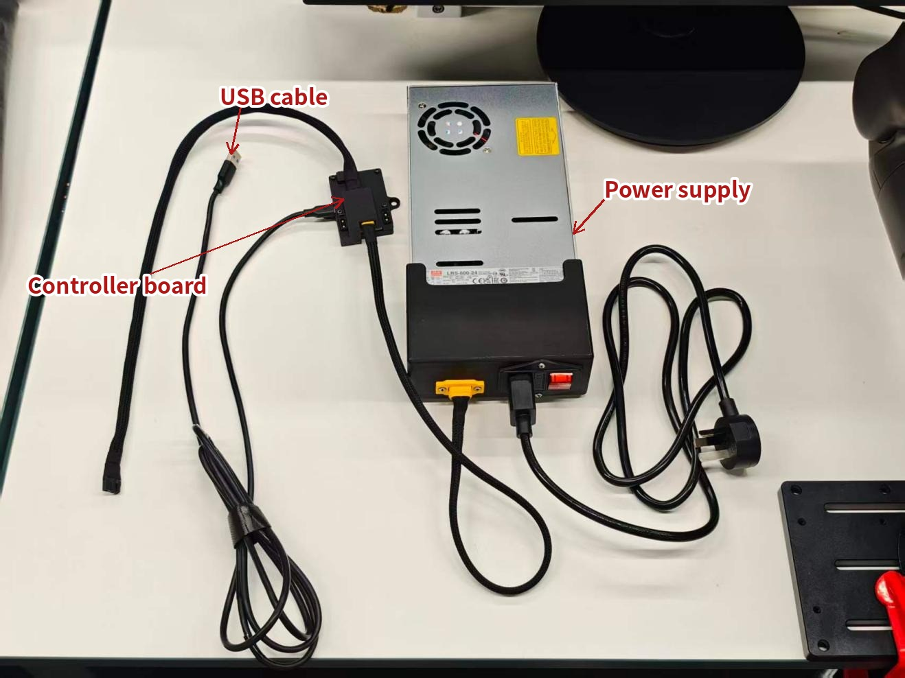

## Wiring self-check

Before you apply power, confirm each of these:

- Every connector is fully seated, with no play and no partial contact.
- Every cable goes to the right connector. Check them one by one against the labels in **Figure 19**.
- Cables are routed clear of the joints' range of motion, so that nothing is pinched or wound up while the arm moves.
- All wiring is complete and confirmed correct. Only then apply power.

## Installation notes

- Disconnect the power before you start. Do not work on a powered arm.
- Make sure every screw is tightened fully, so that nothing works loose while the arm moves.
- Check again before you apply power that every cable is connected correctly and no connector is in the wrong place.
- With the column mount, check the direction of the left and right arms (both power cables point up: the left arm is rotated 90° about the y axis and the right arm -90°; the cable pointing down at the right arm's base is the joint connector cable). An arm mounted the wrong way round will not work.
- After installation, check every fastener and cable connection before you put the arm into service.

The LITEARM-SE is now fully assembled. In the next chapter, install the host application, then connect to the arm to control and tune it.

# Software quick start: install, activate, and use

Once the arm is assembled and powered on, run the host application LiteArm Studio in three steps: install, activate, and use. The published build bundles a Python runtime, the robot-arm SDK, the gripper SDK, and the web interface. The target computer needs no Python, no Node.js, and no clone of the source repository.

## Install

**Download**: <https://github.com/nexform-tech/litearm-studio/releases> (open the latest release). Each release provides the following files, for 64-bit x86 only:

- **Ubuntu 22.04+ / Debian 12+**: `litearm-studio_<version>_amd64.deb` (package)
- **Other 64-bit x86 Linux**: `litearm-studio-<version>-linux-amd64` (single-file build)
- **64-bit Windows**: `litearm-studio-<version>-windows-amd64.exe`

Each file has a matching `.sha256` file beside it; use it to check that the download is intact.

### Windows installation

**Step 1**: download `litearm-studio-<version>-windows-amd64.exe`.

**Step 2**: double-click it to run. The program opens its own application window; you do not need to install Python or any other component.

**Step 3**: on first launch, Windows may show "Windows protected your PC". Click **More info**, then **Run anyway**.

**Step 4**: to verify the file, open PowerShell in the folder containing it and run `certutil -hashfile <filename> SHA256`. Compare the output with the value in the `.sha256` file.

### Linux installation

**Ubuntu 22.04+ / Debian 12+**: install the `.deb`, which also sets the serial-port permission and adds an application-menu entry:

```bash
sudo apt install ./litearm-studio_<version>_amd64.deb
litearm-studio
```

Use `apt install ./<filename>.deb`, not `dpkg -i`; apt resolves dependencies for you.

**Other 64-bit x86 Linux**: use the single-file build. Give it execute permission after downloading:

```bash
chmod +x litearm-studio-<version>-linux-amd64
./litearm-studio-<version>-linux-amd64
```

The single-file build requires glibc 2.35 or later, and GTK 3 and WebKitGTK 4.1 must be installed (on Ubuntu / Debian, run `sudo apt install gir1.2-webkit2-4.1`). Before connecting a real arm, the current user also needs serial-port access:

```bash
sudo usermod -aG dialout "$USER"
```

Log out and back in afterwards. The `.deb` package already includes this rule, so you do not need to repeat it.

Verify the downloaded file:

```bash
sha256sum -c <filename>.sha256
# output ...: OK
```

At startup the program prints its listening address (default `http://127.0.0.1:8765/`) and opens the application window. If the port is in use, it picks the next free one; use the address it prints. **Closing the window exits the program**; refreshing the page does not.

## Activation

Each new arm must be activated before its first use, otherwise **Enable** has no effect. Activation requires a network connection and the arm connected.

**Step 1**: open the **Settings** page and click **License activation**.

**Step 2**: when the page shows **Not activated**, fill in the registration form. Name, phone number, company or organization, email, and region are required.

**Step 3**: select the **Activation registration consent** checkbox.

**Step 4**: click **Submit and activate** and wait a few seconds.

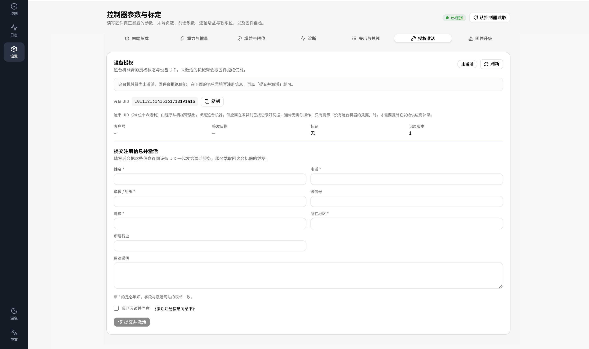{width=100%}

The page showing **Activated** means activation succeeded. If it reports "No credentials for this machine", click **Copy** and send the device UID to your supplier; after they add it, submit again. Activation applies to this arm only. Replacing the arm requires a new activation, and activation cannot be undone in the software.

## Use

Once activation is complete, you can connect to and operate the arm. All of the following happens on the **Console** page.

**Step 1**: the interface connects to the arm automatically after startup. The top bar shows **Connected**, along with the port it detected and the firmware version. If it is not connected, click **Connect**.

**Step 2**: check that the 3D preview on the left shows the arm and that the joint readouts update. The **Fault** field in the top bar should show **None**.

**Step 3**: click **Enable** in the control bar. The arm outputs torque only after it is enabled.

**Step 4**: click **Home**. The arm returns to its zero position at the low speed set by the firmware.

**Step 5**: under **Joint space**, select J1, set the speed to 10–20%, and drag the slider slightly to jog the joint. Check that the motion is smooth.

**Step 6**: press the red **STOP** button on the right and check that the arm drops torque immediately. STOP remains available while the arm is moving.

**Step 7**: open the **Log** page to review the events and samples from this session. Telemetry can be exported as CSV.

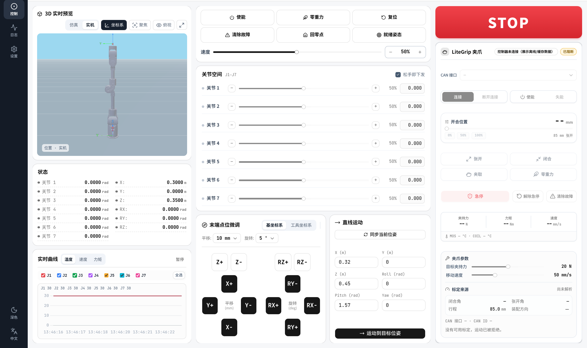{width=100%}

> **Warning**: before you enable the arm or command any motion, clear the arm's working area and confirm that no one and no obstacle is within reach. Use a low speed for the first check, and keep a hand ready on STOP.

# Q&A

**Q: What should I check before applying power?**
A: Complete all wiring with the power off; make sure every connector is fully seated with no play; check each cable and connector against the labels in Figure 19; and route the cables clear of the joints' range of motion. Apply power only after all of this is confirmed.

**Q: Can I still use the arm without the optional 600 W switching power supply?**
A: Yes. Connect another suitable supply to the controller board the same way. Before connecting it, confirm that its specifications match what the controller board requires.

**Q: Can I apply power first and connect the cables afterwards?**
A: No. Complete all wiring with the power off, then connect the power last, so that connectors cannot be mixed up or plugged in wrong.

**Q: The controller board shows no sign of life after power-on, and the arm does not power up either. What should I check?**
A: Check in order: whether the power switch is on; whether the XT60 connector is fully seated; whether the supply output is within spec; and whether the controller board is connected to the port at the base of the arm. If it still does not power up, disconnect the power and recheck the wiring. Never plug or unplug connectors while the power is on.

**Q: Is the cable pointing down at the base of the right arm the power cable?**
A: No, that is the joint connector cable. Both arms' power cables point straight up: the left arm is mounted rotated 90° about the y axis, and the right arm -90°. Do not use the cable pointing down at the right arm's base to judge the mounting direction.

**Q: Which download should I install?**
A: Windows: the `.exe`. Ubuntu 22.04+ or Debian 12+: the `.deb`. Other 64-bit x86 Linux: the `linux-amd64` single-file build. Only 64-bit x86 builds are published; arm64 devices must be built from source.

**Q: On first launch, Windows says "Windows protected your PC". What should I do?**
A: Click **More info**, then **Run anyway**. The program is not code-signed, which does not mean the file is unsafe. Do not turn off SmartScreen for the whole computer because of it.

**Q: Double-clicking the single-file build on Linux does nothing, or reports "Permission denied". What should I do?**
A: The downloaded single-file build has no execute permission. Run `chmod +x <filename>` in a terminal, then run it again. Ubuntu and Debian users can install the `.deb` instead.

**Q: Do I need to restart the computer after installation?**
A: No. Only after running `usermod -aG dialout` on Linux do you need to log out and back in for the serial-port permission to take effect.

**Q: Do I need to uninstall the old version before upgrading?**
A: No. Install the new `.deb` over the old one, or replace the old single-file build with the new file. Settings and activation data are preserved.

**Q: Does installation need administrator rights?**
A: Neither Windows nor the Linux single-file build does; run them directly. Only the `.deb` package needs `sudo apt install`.

**Q: The program starts with no window and reports "no usable webview backend". What should I do?**
A: WebKitGTK is missing. On Ubuntu / Debian, run `sudo apt install python3-gi gir1.2-webkit2-4.1` and restart the program. As a temporary alternative, start it with `litearm-studio --no-open` and open the address it prints in a browser.

**Q: The interface opens but never connects to the arm. What should I check?**
A: Check in order: whether the USB cable connects the controller board to the computer; whether `lsusb` lists a device with VID:PID `1d50:606f`; on Linux, whether the current user is in the `dialout` group and has logged back in; and whether another program holds the serial port. If it still cannot connect, specify the port explicitly with `--port /dev/ttyACM1`.

**Q: Clicking Enable does nothing. What should I do?**
A: The arm is not activated. Complete activation as described in the Activation section. If the activation page reports that the firmware is not supported, upgrade the firmware first.

**Q: The arm goes slack after I close the window. Is that normal?**
A: Yes. The window belongs to the program, so closing it exits the program: the arm is disabled and the serial port is released. Refreshing the page does not exit; only closing the window does.

**Q: Does using the arm require a network connection?**
A: Normal control does not. Only the first activation needs a network connection; after activation the arm can be used offline.

**Q: How do I uninstall the software?**
A: On Ubuntu / Debian, run `sudo apt remove litearm-studio`. For the single-file build, delete the executable. Settings remain in `~/.config/litearm-studio/`; delete them manually if needed.

Thank you for choosing the LITEARM-SE. Product documentation, software updates, and issue reporting are available at the company's code repositories: <https://github.com/nexform-tech>.
