```{=latex}
\begin{titlepage}
\thispagestyle{empty}
\newfontfamily\qsans{Noto Sans CJK SC}
\begin{tikzpicture}[remember picture,overlay]
  % 封面绝对定位，坐标 = 距页面左上角 (pt)，版式对齐 LITEARM SE 产品手册封面
  \node[anchor=north,inner sep=0pt] at ($(current page.north west)+(298.75pt,-108.9pt)$)
      {\includegraphics[width=100pt,height=112pt,keepaspectratio]{images/cover_litearm_logo.png}};
  \node[anchor=center] at ($(current page.north west)+(298.75pt,-262.4pt)$)
      {{\fontsize{28}{34}\selectfont\qsans\bfseries 安装教程}};
  \node[anchor=north,inner sep=0pt] at ($(current page.north west)+(298.75pt,-300.8pt)$)
      {\includegraphics[width=289.1pt,height=289.1pt,keepaspectratio]{images/cover_litearm_se.png}};
  \node[anchor=center] at ($(current page.north west)+(298.75pt,-717.8pt)$)
      {{\fontsize{11}{14}\selectfont\bfseries NEXFORM ROBOTICS}};
  \node[anchor=center] at ($(current page.north west)+(298.75pt,-747.9pt)$)
      {{\fontsize{9}{13}\selectfont\qsans 版本：V1.0\qquad 日期：2026年10月13日}};
\end{tikzpicture}
\end{titlepage}
\pagenumbering{Roman}
\thispagestyle{frontmatter}
\tableofcontents
\clearpage
\pagenumbering{arabic}
```

# 前言

第一次安装一台机械臂，需要经过哪些步骤，才能让它真正完成装配并可靠运行？对于刚接触机械臂的开发者、工程师与机器人爱好者而言，安装阶段的目标往往不是写代码，而是先把设备安全、牢固地装配并连通起来。

本教程以 LITEARM-SE 机械臂为对象，覆盖从开箱清点、整机安装，到电气连接的完整硬件安装流程，暂不涉及软件开发与运动调试。请在安装前仔细阅读本教程，并核对装箱部件是否齐全。

安装顺序是**先装好机械臂，再接电接线**。机械臂在装配过程中需要翻转、对孔、拧紧，先完成这些动作再接线，线缆不会在装配途中被牵拉，也不会缠进关节运动范围。

LITEARM-SE 支持两种安装方式，可根据实际使用场景任选其一。两种方式共用同一套电气连接流程：

- **安装方式一｜桌面固定**：使用安装底板与 G 型夹，将机械臂固定在桌面边缘，适用于工作位置固定的场景。
- **安装方式二｜立柱安装**：使用 X 型底板、脚杯、脚轮、立柱与顶部安装件组成立柱底架，再将机械臂装配于其上，适用于需要调整安装高度或采用遥操形态的场景。

**关键词**：机械臂安装，开箱清点，桌面固定，立柱安装，电气连接

## 安装路径指引

两条安装路径**不需要都做**。请先确认自己的安装方式，再按下表阅读：第 2 章与第 5 章两条路径都要看，区别只在第 3 章与第 4 章二选一。

| 章节 | 内容 | 桌面安装 | 立柱安装 |
| --- | --- | --- | --- |
| 1 | 前言 | 必读 | 必读 |
| 2 | 开箱清点：确认部件是否齐全 | 必读 | 必读 |
| 3 | 桌面固定：将机械臂稳定固定于桌面 | **必读** | 可跳过 |
| 4 | 立柱安装：组装立柱底架并装配机械臂 | 可跳过 | **必读** |
| 5 | 电气连接：接通供电与通讯 | 必读 | 必读 |
| 6 | 安装注意事项 | 必读 | 必读 |

- **采用桌面安装**：阅读第 2、3、5、6 章，**第 4 章整章可以跳过**。
- **采用立柱安装**：阅读第 2、4、5、6 章，**第 3 章整章可以跳过**。

# 开箱清点：确认部件是否齐全

在开始安装之前，请先核对包装内的机械臂与配件是否齐全。装箱清单如下：

- 机械臂本体
- 控制板
- USB 线
- 机械臂电源输出
- 600 W 开关电源套件（选配）
- 桌面固定套件（选配）
- 立柱套件（选配）

清点时请注意以下几点：

- 请根据所选安装方式一并核对安装件。选择**桌面固定**时，需确认桌面固定套件齐备；选择**立柱安装**时，需确认立柱套件齐备。
- 清单中的控制板、USB 线与机械臂电源输出均在第 5 章中使用，建议集中放置，便于后续接线。
- 建议先完成清点，暂不要接通电源。
- 若发现部件缺失或损坏，请先联系售后处理，请勿使用非配套零件强行安装。

# 桌面固定：将机械臂稳定固定于桌面

机械臂在运动过程中会产生一定的惯性与反作用力。若底座固定不牢，运动时可能导致底座位移，影响运行稳定性，甚至带来安全风险。因此在进行后续通电与动作测试之前，应先将机械臂底座固定在稳定的安装位置上。

桌面固定使用安装底板与 G 型夹完成，适用于桌面边缘等固定工位。采用立柱安装的用户请直接阅读第 4 章。

**步骤 1**：使用配套 M5 螺丝，将机械臂固定在安装底板上。

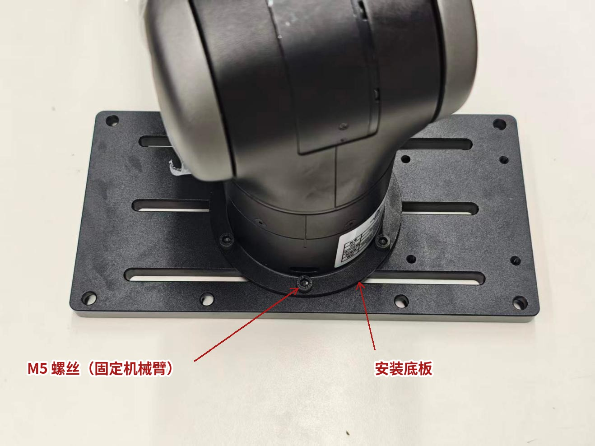

**步骤 2**：将底板放置在桌面边缘合适位置。


**步骤 3**：使用 G 型夹，将底板夹紧固定在桌面上。

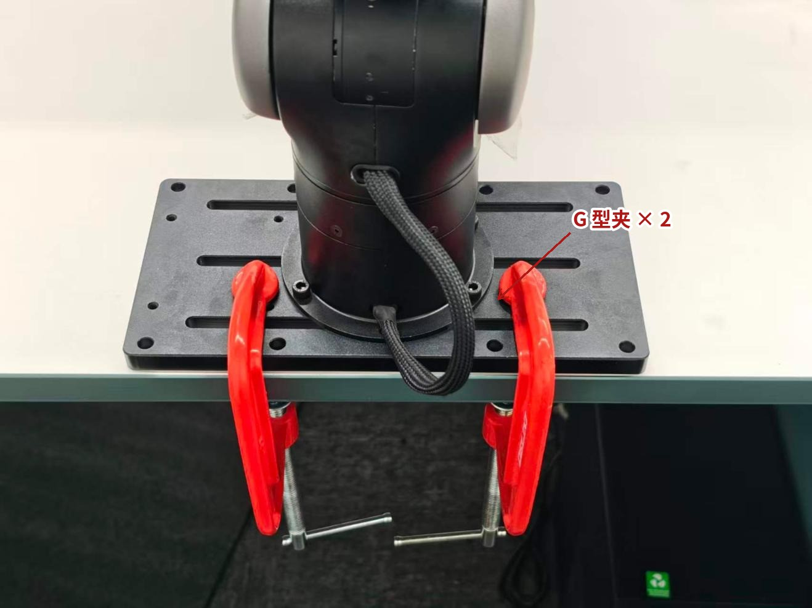

**步骤 4**：确认底板与桌面之间固定牢固、无松动。

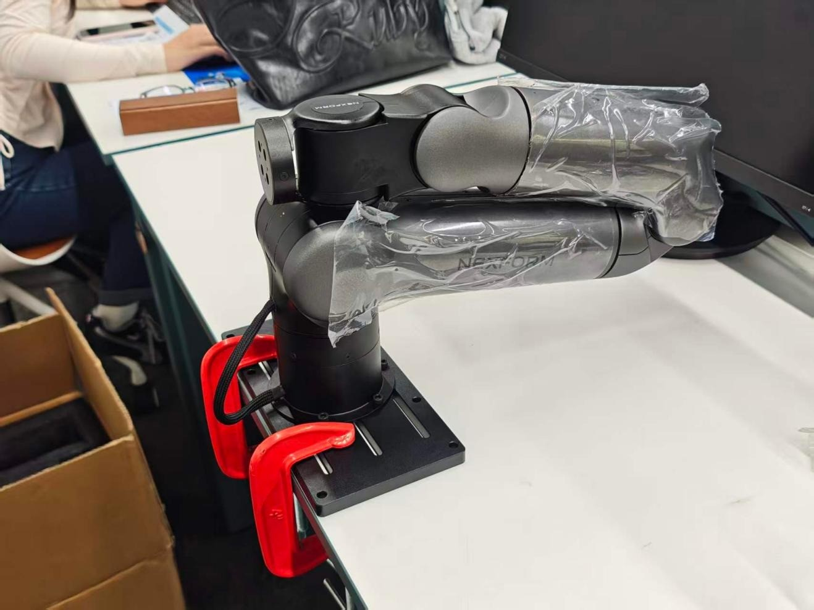

**步骤 5**：使用配套螺丝，将控制板固定在安装底板上，即完成桌面固定。

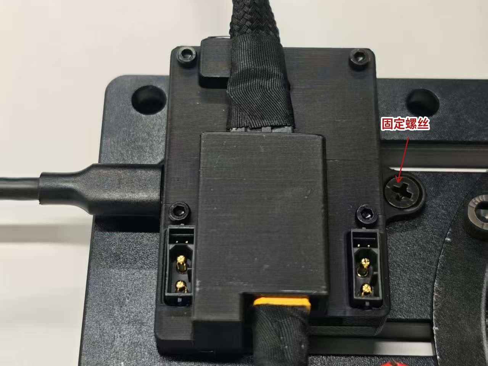

> **建议**：拧紧螺丝时，先让全部螺丝对正孔位，再依次拧紧，避免单颗螺丝一次拧死导致孔位偏移、其余螺丝难以对正。

# 立柱安装：组装立柱底架并装配机械臂

立柱安装的全部机械装配工作在本章一次完成：先用 X 型底板、脚杯、脚轮与立柱组装立柱底架，再把机械臂装配到立柱上，最后完成立柱内部走线。步骤 1 至步骤 8 接续进行。整体装配效果见**图 6**。

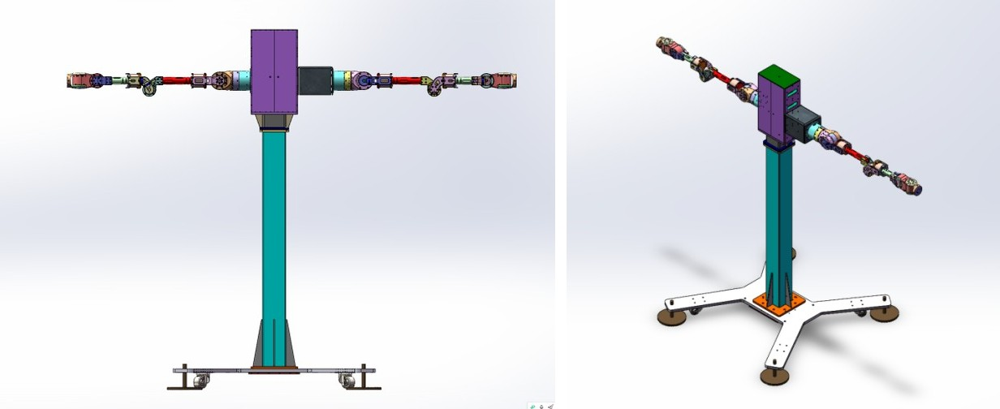

**步骤 1**：将 X 型底板倒置放平，将 4 个脚杯分别装入末端 M16 孔内。

> **注意**：不要取下脚杯上的螺母。

**步骤 2**：使用 M8 带垫片的螺丝，依次将 4 个脚轮安装在底盘背面。

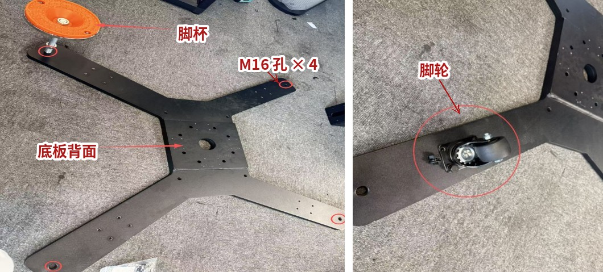

**步骤 3**：将装好脚杯、脚轮的底板翻转至正面；将立柱底部孔位对准底板孔位，使用 8 个 M10 外六角螺丝及垫片、螺母进行装配。

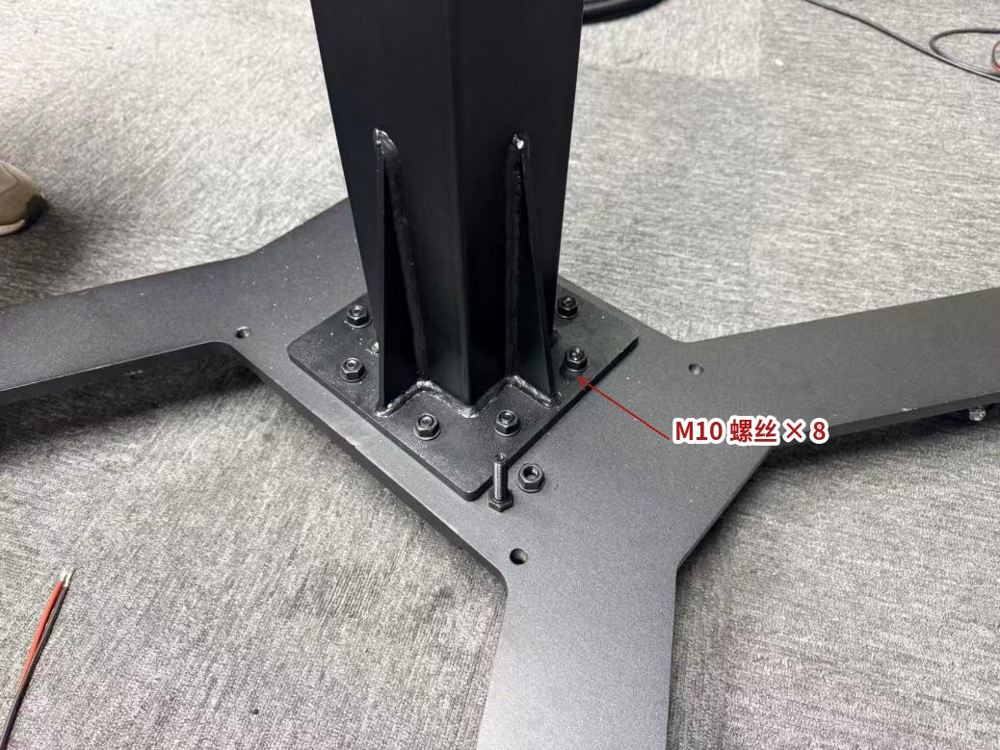

**步骤 4**：将带有「NEXFORM」LOGO 的顶部安装件，使用 4 个 M6 内六角螺丝与立柱顶面进行装配。

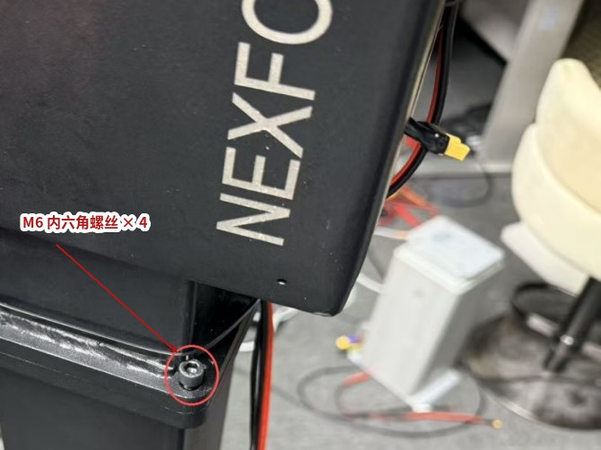

立柱底架组装完成后，即可将机械臂装配至立柱上。按使用需求，机械臂有两种装配形态，**二者选其一**：需要遥操时采用「遥操形态」（需先加装延长件，见步骤 5、步骤 6），需要正常控制机械臂时采用「直接装配」（见步骤 7）。

**步骤 5**：如需遥操机械臂，需先将延长件进行装配。

**步骤 6**：先将延长件内部无螺母端，孔位对照所需高度，依次使用 6 个 M5 螺丝与带有「NEXFORM」LOGO 的零件进行装配；再使用 6 个 M5 螺丝，将机械臂装配到延长件上。

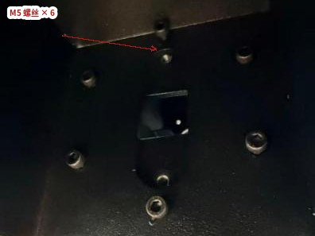

**步骤 7**：如需正常控制机械臂，可按所需高度，使用 6 个 M5 螺丝直接将机械臂装配到立柱上。


**步骤 8**：立柱内部走线。装配机械臂时，使用延长线将机械臂的电源线引入立柱内部，并从立柱下方穿出；穿出后的接线见下一章电气连接。

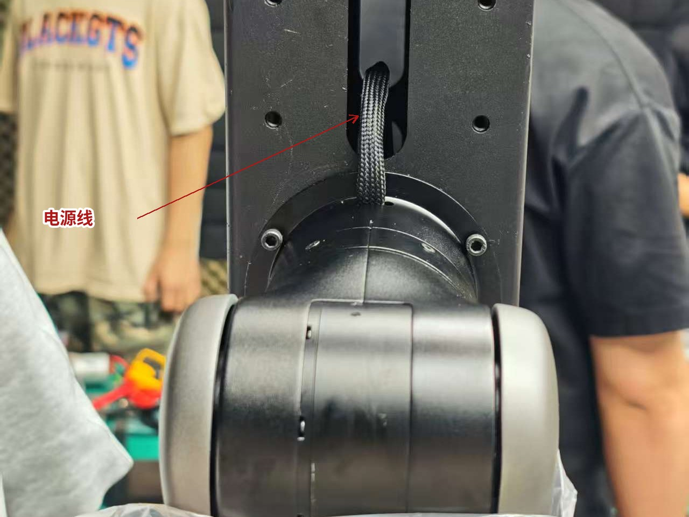

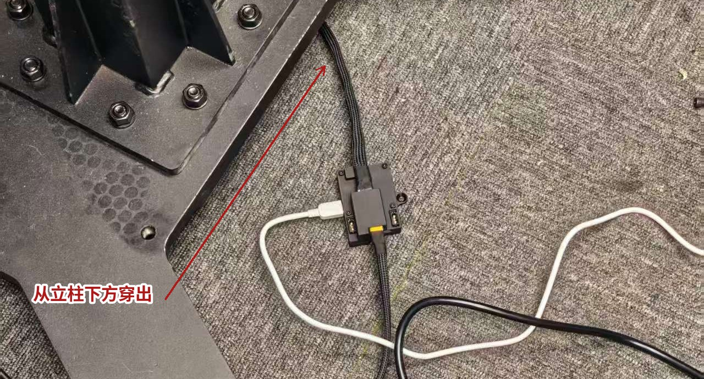

> **注意**：安装方向不同，侧装时的侧装参数也不同。两臂的电源线都**竖直朝上**（见**图 14** 左臂）：左臂安装方向为绕 y 轴旋转 90°，右臂为绕 y 轴旋转 -90°。**图 14** 右臂根部那根**竖直朝下**的线是**关节连接线**，不是电源线，不要拿它判安装方向。

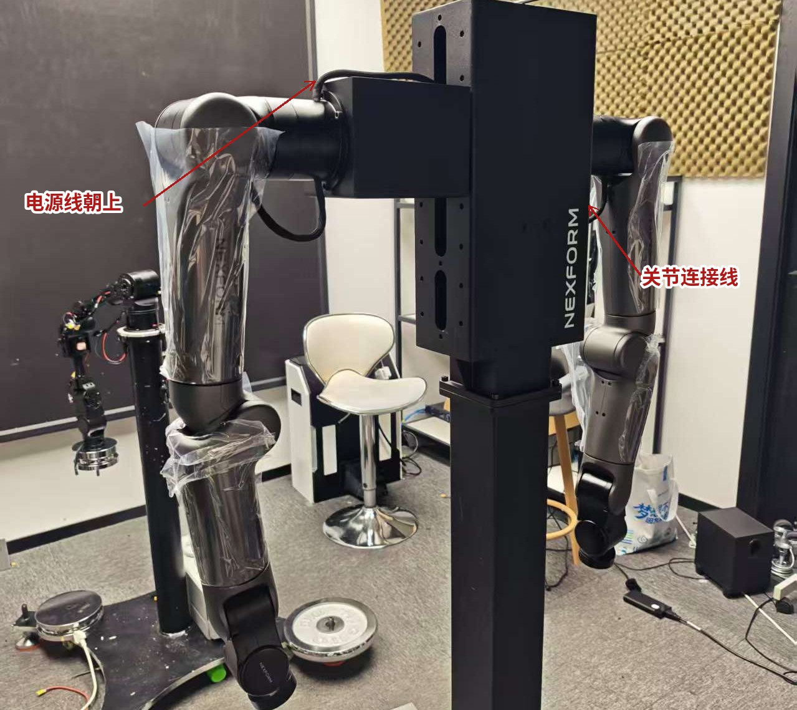

# 电气连接：接通供电与通讯

机械臂装配完成后再进行电气连接。LITEARM-SE 的系统供电与上位机通讯均由这一组线缆完成，建议在完全断电的状态下完成全部接线，最后再接入电源，可有效避免接口混淆或误接。

**步骤 1**：将电源线接入电源模块，为系统供电。

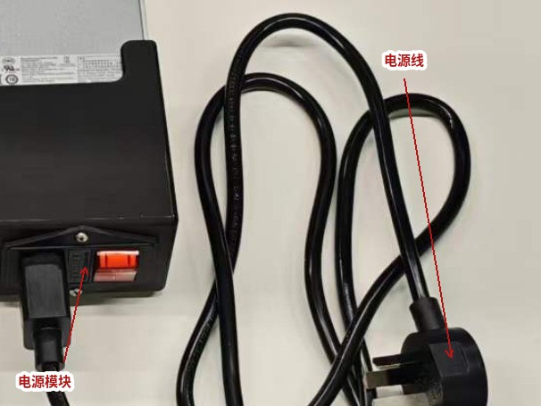

**步骤 2**：将电源输出的 XT60 接头接至控制板。若未选配电源模块，可改用其他可用电源接入控制板，接法相同。

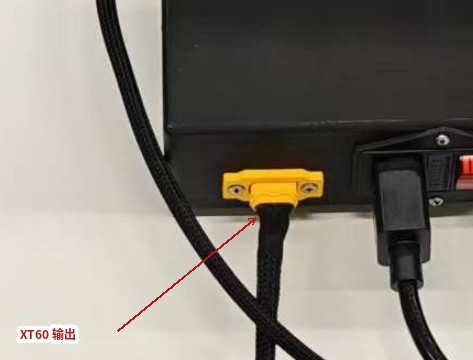

**步骤 3**：将控制板与机械臂下方接口连接。

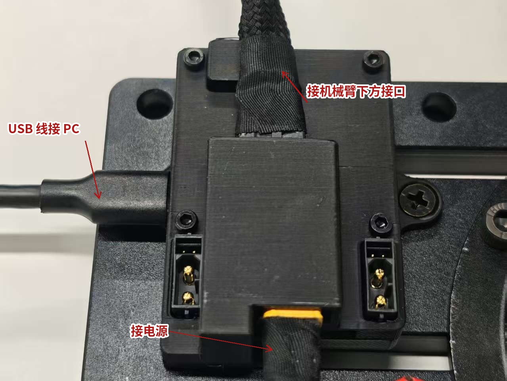

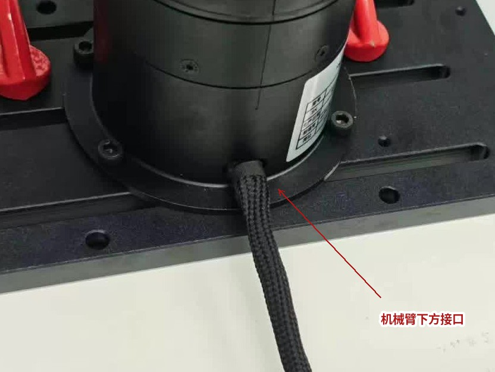

**步骤 4**：使用 USB 线连接控制板与 PC 端。

## 电气连接示意图

各线缆及接口与**图 19** 一一对应。

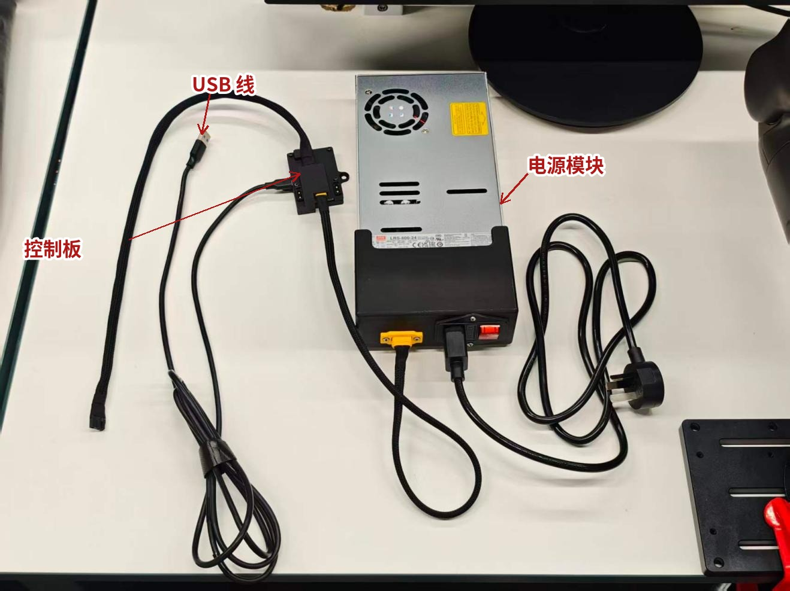

## 接线自检

在接入电源之前，请逐条确认：

- 各接头是否插接到位，有无松动或虚接。
- 线缆与接口的对应关系是否正确，可对照**图 19** 的标签逐一核对。
- 线缆走向是否已整理，避免进入机械臂各关节的运动范围，防止运行中被夹住或缠绕。
- 全部接线完成并确认无误后，再接通电源。

# 安装注意事项

- 安装前请先断开电源，避免带电操作。
- 确保所有螺丝紧固到位，防止运行中松动。
- 通电前请再次确认线缆连接正确、接口无错接。
- 立柱安装时请确认左右臂方向（两臂电源线均朝上，左臂绕 y 轴旋转 90°、右臂旋转 -90°；右臂根部朝下那根是关节连接线），避免装反。
- 安装完毕后，请务必全面检查各紧固件与线缆连接，确认无误后再投入使用。

至此，LITEARM-SE 机械臂的安装已全部完成。接下来可安装 SDK，或使用上位机软件连接机械臂，进行控制、标定与运动调试。

SDK、上位机软件与相关文档的下载地址：<https://github.com/nexform-tech>

感谢您选用本产品，祝您使用顺利。
